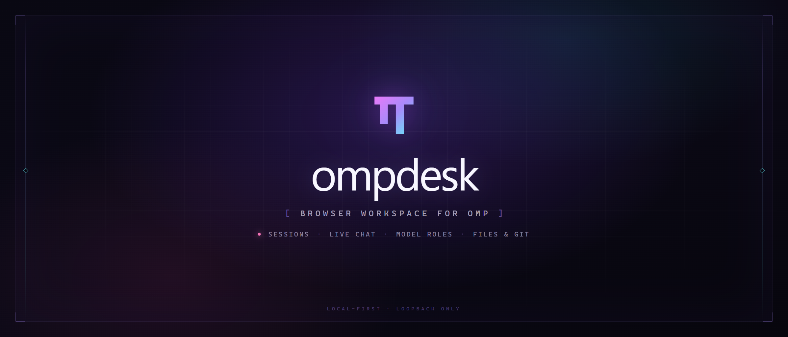
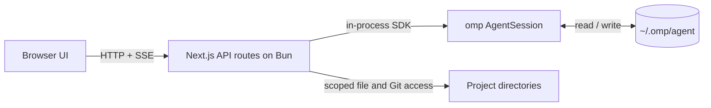

<p align="center">
  
</p>

<p align="center">
  <strong>English</strong> · <a href="./README.zh-CN.md">简体中文</a>
</p>

<p align="center">
  <a href="https://www.npmjs.com/package/ompdesk"></a>
  <a href="https://github.com/ZouZhao321/ompdesk/blob/main/LICENSE"></a>
  <a href="https://www.typescriptlang.org"></a>
  <a href="https://bun.sh"></a>
</p>

<p align="center">
  Fork of <a href="https://github.com/agegr/pi-web">pi-web</a> by <a href="https://github.com/agegr">@agegr</a>,
  built on the <a href="https://github.com/can1357/oh-my-pi">omp (oh-my-pi)</a> SDK.
  ompdesk develops independently of both projects.
</p>

ompdesk is a browser workspace for [omp](https://github.com/can1357/oh-my-pi). omp is a terminal coding agent in the same family as Claude Code, Codex, and pi. Use ompdesk to follow a long run from a phone, review the files and diffs an agent changed, or find an earlier conversation without scrolling terminal output.

It is a single-user tool for one machine, with no model provider, no team accounts, and no hosted service. If you work only at the terminal, omp alone is enough.

It reads the sessions the `omp` CLI already writes and runs omp's own SDK in-process against the same `~/.omp/agent` directory. A conversation started in a terminal continues in the browser, and the reverse.

It is not a separate agent and does not copy omp's data: sessions, settings, model roles, credentials, skills, plugins, extensions, and Model Context Protocol (MCP) configuration are the ones omp already uses.

Because a browser tab can drive a high-privilege agent, ompdesk binds to the loopback interface only and ships a password lock. Remote access is expected to go through a private network such as Tailscale, not a public port.

## Quick Start

ompdesk serves its API on **Bun**: the omp SDK is published as TypeScript sources and imports `bun:` builtins, so Node cannot load it. Install Bun 1.4.2 or newer:

```bash
curl -fsSL https://bun.sh/install | bash        # macOS / Linux
powershell -c "irm bun.sh/install.ps1 | iex"    # Windows
```

Run the latest published version:

```bash
bunx ompdesk@latest
```

Open [http://127.0.0.1:30141](http://127.0.0.1:30141). The launcher opens the browser for you once the server is ready.

`ompdesk` starts in the background and returns to the prompt, so closing the terminal does not stop the server or the agent turns it is running. Ask it for its state and stop it with the same command:

```bash
ompdesk status    # running or not, the address, and what each project is doing
ompdesk stop      # refuses while a task is running
ompdesk stop --force
```

`status` and `stop` cover every instance recorded for the current agent directory; `--port <port>` narrows them to one. Each instance records itself and its run log in that directory, so a second `ompdesk` on the same port reports the address of the running one instead of failing on the port. `ompdesk foreground` runs the server attached to the terminal instead — that is the form a container or a service manager wants.

Install it globally instead:

```bash
bun add -g ompdesk        # or: npm install -g ompdesk
ompdesk
```

The `ompdesk` entrypoint runs under Node or Bun, locates a Bun runtime, and re-executes the server there. Pin a specific Bun build with `OMPDESK_BUN=/path/to/bun`.

### Commands

| Command | Effect |
| --- | --- |
| `ompdesk` / `ompdesk start` | Start in the background and return to the prompt. |
| `ompdesk status` | Report each recorded instance: running or not, address, pid, and per-project session counts. |
| `ompdesk stop` | Stop the recorded instances. Refuses while a session is mid-turn; `--force` interrupts it. |
| `ompdesk foreground` | Run the server attached to this terminal, for containers and service managers. |

### Options

| Option | Effect |
| --- | --- |
| `-p, --port <port>` | Listen port. Defaults to `30141`; `PORT` also works. Also selects one instance for `status` and `stop`. |
| `-H, --hostname <host>` | Listen address. Non-loopback values are refused unless `OMPDESK_ALLOW_NON_LOOPBACK` is set for a container. |
| `-f, --force` | With `stop`: interrupt running tasks instead of refusing. |
| `--no-open` | Do not open the browser automatically. |
| `--authenticated` | Turn the password lock on for this run and later ones. Asks for a password when none exists and the terminal is interactive. |
| `--reset-password` | Replace the stored password without knowing the old one. Requires a shell on the server. |

### Environment

| Variable | Purpose |
| --- | --- |
| `PORT` | Default listen port. |
| `OMPDESK_HOSTNAME` | Default listen address. |
| `OMPDESK_NO_OPEN=1` | Same as `--no-open`; useful for services. |
| `OMPDESK_AUTHENTICATED=1` | Same as `--authenticated`. |
| `OMPDESK_PASSWORD` | Use this password for every request and override the stored credential. |
| `OMPDESK_AUTH_FILE` | Store the password hash somewhere other than `~/.omp/agent/ompdesk-auth.json`. |
| `OMPDESK_ALLOWED_HOSTS` | Extra exact hostnames accepted by the request check, comma separated. Set it when a trusted reverse proxy uses another name. |
| `OMPDESK_TRUST_PROXY=1` | Trust the last `x-forwarded-for` hop for rate-limit bucketing. Only set it behind a proxy you control. |
| `OMPDESK_ALLOW_NON_LOOPBACK=1` | Skip the loopback-only check. The Docker image sets it; do not use it on a host. |
| `OMPDESK_BUN` | Bun executable used by the launcher. |
| `OMPDESK_STARTUP_TIMEOUT_MS` | How long `start` waits for the port to answer before giving up. Defaults to 120000. |
| `OMPDESK_DIST_DIR` | Serve a build directory other than `.next`. `next.config.ts` reads the same variable. |
| `PI_CODING_AGENT_DIR` | Use another omp agent directory instead of `~/.omp/agent`. |
| `HTTP_PROXY`, `HTTPS_PROXY`, `NO_PROXY` | Proxy for server-side model and provider requests. Bun reads them once at startup. |

## Password access

The lock is HTTP Basic Auth on every page and API route, with the fixed username `omp` and the password as the only secret. Three ways to turn it on:

- **Settings → Access** sets a password and switches the lock on or off.
- **`ompdesk --authenticated`** enables it for this run and every later one.
- **`OMPDESK_PASSWORD`** overrides the stored credential for as long as it is set.

The password is stored as a `scrypt` digest in `~/.omp/agent/ompdesk-auth.json` with mode `0600`. The plaintext is never written anywhere. If it is lost, run `ompdesk --reset-password` on the server, or open `/recover` and enter the one-time code ompdesk prints on its own console.

Basic Auth authenticates but does not encrypt. Do not expose plain HTTP to an internet path: put a TLS reverse proxy or a trusted VPN in front of anything that leaves the machine. Full details, including the recovery limits: [docs/authentication.md](./docs/authentication.md). Report vulnerabilities privately through [SECURITY.md](./SECURITY.md), not a public issue.

## Deployment

ompdesk listens on `127.0.0.1` and nowhere else. A `--hostname` or `OMPDESK_HOSTNAME` that points at a LAN or public address is refused, and the dev and start scripts keep the same rule. The port's reachability is the trust boundary: whatever can connect can read files, run commands, and spend model credits.

**Local.** `bunx ompdesk@latest`, then <http://127.0.0.1:30141>.

**Docker.** The image runs ompdesk under Bun and mounts the omp home so terminal sessions stay visible:

```bash
OMPDESK_PASSWORD='a-long-random-password' \
OMP_UID=$(id -u) OMP_GID=$(id -g) docker compose up --build
```

The port is published on loopback only; the container needs `0.0.0.0` inside its own network namespace. Volume layout and UID/GID matching: [docs/docker.md](./docs/docker.md).

**Remote.** Forward the loopback port into a tailnet instead of opening a public port:

```bash
tailscale serve --bg --tcp=30141 tcp://localhost:30141
```

On the phone open `http://<tailnet IPv4>:30141` (read the address with `tailscale ip -4`) and sign in as `omp`. Walkthrough, verification, and troubleshooting: [docs/tailscale.md](./docs/tailscale.md) (Chinese). Deployment rules: [docs/deployment.md](./docs/deployment.md) (Chinese).

## What you can do

### Sessions and projects

- Browse every project omp has a session for, with search across project names and session titles.
- Sort projects by recent activity or name, pin the ones you use, and add a project from any allowed directory.
- Read session state at a glance: running, waiting for an answer, unread, completed, interrupted, cancelled, or failed. Browser notifications cover runs that finish while the tab is in the background.
- Rename, archive, restore, and delete sessions; archived sessions stay on disk.
- Follow forks as a tree and switch between branches without leaving the sidebar.
- Start a session in the selected project or a custom working directory, and switch Git worktrees from the Git tab in the right panel.
- Install the interface as a progressive web app (PWA) on a phone; the layout and hit targets adapt to small screens.

### Chat and agent runs

- Stream assistant text, thinking, tool calls, and tool results over server-sent events (SSE) while the run is in progress.
- Queue a follow-up or steer the current run; stop a run, compact the context, or recall queued messages for editing.
- Use `/` commands, `@` file mentions, prompt history, image attachments, and drag-and-drop images.
- Pick a model or a model role, set the reasoning level (including `auto`), and choose a tool preset.
- Rewind the last user turn on the current branch, returning its text and images to the composer.
- Run goal mode with an objective, pause/resume controls, and an optional token budget.
- Answer plan approvals, agent questions, and extension prompts without leaving the chat.
- Open the subagent panel to watch running and finished subagents with their live transcript.
- Open the conversation map for a per-turn view of the session, then fork from a turn or switch lines.
- Export the full history as a standalone HTML page.

### Models and providers

- Assign models per role: `default`, `smol`, `slow`, `vision`, `plan`, `commit`, `tiny`, `memory`, `task`, and `advisor`.
- Switch a session onto a role from the chat bar; the role is recorded with the turn, matching what `/model` does in the TUI.
- Configure providers, OAuth logins, and API keys; discover upstream models; test a provider or model; browse models.dev pricing data.
- Read and write `models.yml` from the Models panel.
- Manage MCP servers for the user or the current project, install and toggle plugins, and list, search, install, update, or disable skills.

### Files, Git, and code comments

The right panel is a tabbed workspace:

- **Explorer** shows the project tree, uploads files, refreshes on demand, and marks changed files. Open a file to preview source, diff, Markdown (with Mermaid and KaTeX), HTML, images, audio, PDF, or DOCX.
- **Git** lists working-tree changes against `HEAD`, with status letters and a file count, and opens a per-file diff.
- **Subagents** lists running and finished subagents and opens their execution details.
- **Comments** scans `//` and `/* */` comments in `.ts` and `.tsx` files, shows Chinese and English side by side, and stores manual or model-generated translations in a local dictionary.

Images support zoom, pan, fit, actual size, and fullscreen preview. Source and preview views can be toggled, and a selected line range can be inserted into the chat as a mention.

## Model roles

omp has a model per scope of work, not one global model. ompdesk exposes the same roles the TUI's `/model` selector and `Ctrl+P` cycle use:

| Role | What it runs |
| --- | --- |
| `default` | Ordinary turns |
| `smol` | Cheap, fast subagent and background work |
| `slow` | Deep reasoning on hard problems |
| `vision` | Turns that carry images |
| `plan` | Plan mode |
| `commit` | Commit messages and changelogs |
| `tiny` | Classification and routing |
| `memory` | Memory extraction and background memory upkeep |
| `task` | The model subagents spawn with |
| `advisor` | The second model that reviews every turn |

The chat bar's model picker lists roles above the flat model list. Picking a role switches the session onto that role's model and records the role, so the transcript and omp's retry fallbacks agree on what drove the turn.

**Models → Model roles** assigns a model to each role. Assignments are written to `modelRoles` in `~/.omp/agent/config.yml`, or to `.omp/config.yml` when you pick **This project**; the CLI reads the same record. Provider and model definitions are separate and live in `models.yml`.

Session titles use omp's own generator, which resolves through the `tiny` → `commit` → `smol` chain instead of the session's primary model. The reasoning selector keeps `auto` across reloads and shows the resolved effort separately, for example `auto (high)`.

## How it works



Session browsing reads `.jsonl` files without creating an `AgentSession`. Sending a message or running a command starts one in-process through `startRpcSession()`. Extensions are bound through omp's `initializeExtensions()`, with a browser-side implementation of `ExtensionUIContext` layered on top.

There is one `Settings`, one `AuthStorage`, and one `ModelRegistry` in the process. Writes to credentials or `models.yml` invalidate both the runtime and the model cache, so the browser does not keep serving a stale provider list.

### State on disk

| Path | Contents |
| --- | --- |
| `~/.omp/agent/sessions/<encoded-cwd>/<timestamp>_<uuid>.jsonl` | Session records, one JSON object per line, `version: 3`. |
| `~/.omp/agent/config.yml` | omp settings, model roles, and theme mappings. A project can override roles in `.omp/config.yml`. |
| `~/.omp/agent/models.yml` | Provider and model definitions. |
| `~/.omp/agent/agent.db` | Credentials shared with the CLI. |
| `~/.omp/agent/ompdesk-auth.json` | Password hash for the web lock. |
| `~/.omp/agent/ompdesk-comment-dictionary.json` | Saved comment translations. |
| `~/.omp/logs/omp.<day>.<pid>.log` | Rotating structured runtime log. |

### Trust and file access

Opening a repository in a browser tab must not execute its code. ompdesk therefore gates a project's `.omp/extensions`, `.omp/hooks`, `.omp/tools`, and `.mcp.json` behind an explicit trust decision. Skills, rules, prompts, and `AGENTS.md` are data folded into the prompt, so they load either way. See [docs/project-trust.md](./docs/project-trust.md).

File browsing is not a general filesystem browser. `/api/files` allows the session working directory, its repository root, `~/omp-cwd-*` directories, and roots added through validated endpoints.

### Configuration notes

- **Agent directory**: `PI_CODING_AGENT_DIR` points ompdesk and the password store at another omp home.
- **System prompts**: `SYSTEM.md` and `APPEND_SYSTEM.md` resolve project-first (`.omp/`, `.claude/`, `.codex/`, `.gemini/`) and then user-level (`~/.omp/agent/`), against the session's own working directory.
- **Proxy**: ompdesk passes the standard proxy variables through to Bun. The launcher adds loopback hosts to `NO_PROXY` so a local provider (Ollama, LM Studio, llama.cpp) keeps working; Bun reads the variables once at startup.
- **Runtime logs**: every request, agent run, tool call, security decision, and audit action is written as structured JSON and can be read, searched, and downloaded from **Settings → Logs**. Record shape, levels, and `OMP_LOG_LEVEL` / `OMPDESK_LOG_STDOUT`: [docs/logging.md](./docs/logging.md).
- **Telemetry**: set `OTEL_EXPORTER_OTLP_ENDPOINT` to export traces, logs, and metrics over OTLP `http/protobuf`. With no endpoint, no exporter loads. Prompt and reply text stay out unless `OTEL_INSTRUMENTATION_GENAI_CAPTURE_MESSAGE_CONTENT=full` is set. Supported variables and per-signal switches: [docs/telemetry.md](./docs/telemetry.md) (Chinese).
- **Worktrees**: the branch switcher sits at the top of the Git tab for Git repository roots and covers new sessions, the Explorer, and file mentions. Creation and removal rules: [docs/worktrees.md](./docs/worktrees.md).
- **Forks**: **Fork** creates a new `.jsonl` file. **Edit from here** creates another branch inside the same session file.
- **Skills**: the installer runs `npx skills add ... --agent claude-code`, which writes the `.claude/skills` layout omp discovers by default.
- **Interface language**: English and Simplified Chinese ship today; the initial locale follows the browser, and the top bar switch persists the choice in `localStorage`. Adding a language: [docs/i18n.md](./docs/i18n.md).

### Embedding

Electron wrappers and other downstream integrations can provide a session-row context menu without patching `SessionSidebar`. Listen for the cancelable `pi-web:session-row-contextmenu` event and call `preventDefault()` synchronously when the integration handles it:

```js
window.addEventListener("pi-web:session-row-contextmenu", (event) => {
  event.preventDefault();
  const { id, path, cwd, name, clientX, clientY, refresh } = event.detail;

  void openSessionMenu({ id, path, cwd, name, clientX, clientY }).then((changed) => {
    if (changed) refresh();
  });
});
```

The detail object carries `id`, `path`, `cwd`, optional `name`, pointer coordinates, and a `refresh()` callback for actions that change the session list. If no listener cancels the event, the browser's native context menu stays in place. This hook is browser-side and independent of omp agent extensions.

## Development

```bash
bun install
bun run dev
```

The dev server runs at [http://127.0.0.1:30141](http://127.0.0.1:30141).

Common checks:

```bash
bun run typecheck
bun run lint
bun test
```

Do not run `bun run build` during local development: it writes to `.next/` and interferes with the dev server. `bun run ci` and `bun run verify` run the production build plus the dev smoke test for release work.

### Project structure

| Path | Responsibility |
| --- | --- |
| `app/` | App Router page, recovery page, manifest, and one `route.ts` per API endpoint. |
| `components/` | Chat, sidebar, right-panel tabs, settings panels, and file viewers. |
| `hooks/` | Client-side session, stream, theme, layout, i18n, and preference state. |
| `lib/` | Session reader, runtime registry, model roles, file access, trust, Git, logging, telemetry, and comment translation. |
| `bin/` | Launcher, Bun discovery, option parsing, and password storage. |
| `proxy.ts` | Password, host, and cross-site checks. |
| `instrumentation.ts` | Startup wiring for the HTTP dispatcher and logging. |
| `scripts/` | Scratch directories, dev smoke test, and commit-message validation. |
| `docs/` | Deployment, authentication, logging, telemetry, worktrees, trust, i18n, release, and ADRs. |

### Documentation

- [Deployment](./docs/deployment.md) (Chinese): loopback rule, local, Docker, and remote access.
- [Password access](./docs/authentication.md): storage, recovery, and the threat model.
- [Security policy](./SECURITY.md): supported versions, reporting, and scope.
- [Logging](./docs/logging.md): record shape, event names, levels, and what is never logged.
- [Telemetry](./docs/telemetry.md) (Chinese): OTLP endpoints, signals, flush timing.
- [Project trust](./docs/project-trust.md): what is gated and why.
- [Worktrees](./docs/worktrees.md): switching, creating, and removing checkouts.
- [Internationalization](./docs/i18n.md): adding languages and UI text.
- [Release checklist](./docs/release.md): npm and GitHub release flow.

## Contributing

Bug reports and feature requests go through the GitHub issue forms. Every issue gets an answer, but an issue is not a scheduling commitment; accepted work is planned by the maintainers and the outcome is reported back on the issue. See [CONTRIBUTING.md](CONTRIBUTING.md).

## License

[MIT](LICENSE).
