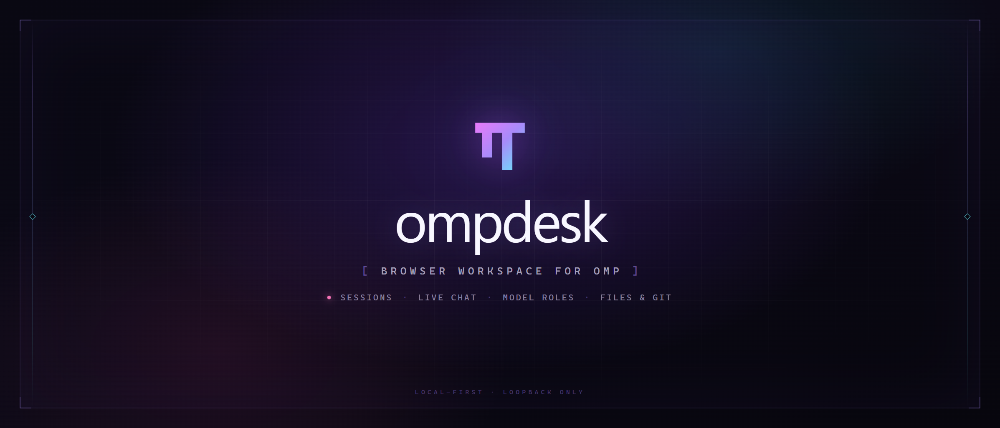
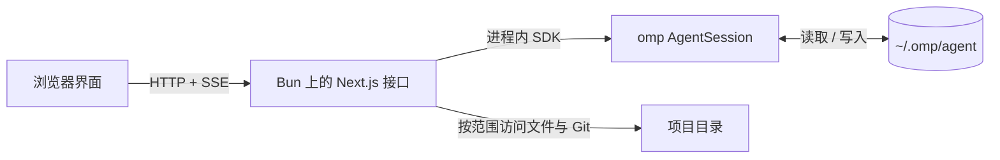

<p align="center">
  
</p>

<p align="center">
  <a href="./README.md">English</a> · <strong>简体中文</strong>
</p>

<p align="center">
  <a href="https://www.npmjs.com/package/ompdesk"></a>
  <a href="https://github.com/ZouZhao321/ompdesk/blob/main/LICENSE"></a>
  <a href="https://www.typescriptlang.org"></a>
  <a href="https://bun.sh"></a>
</p>

<p align="center">
  Fork 自 <a href="https://github.com/agegr/pi-web">pi-web</a>（作者 <a href="https://github.com/agegr">@agegr</a>），
  基于 <a href="https://github.com/can1357/oh-my-pi">omp（oh-my-pi）</a> 的 SDK。
  ompdesk 与这两个项目独立发展。
</p>

ompdesk 是 [omp](https://github.com/can1357/oh-my-pi) 的浏览器工作台。omp 是终端里的编码代理，和 Claude Code、Codex、pi 属于同一类工具。适合这样的使用方式：在手机上跟进跑了很久的任务，在浏览器里查看 agent 改过哪些文件和差异，或者不翻终端输出就找回之前的会话。

它是单人、单机的工具，不提供模型、团队账号或托管服务。只在终端工作时，omp 本身已经够用。

它读取 `omp` 命令行工具已经写好的会话，在同一个进程里运行 omp 自己的 SDK（开发工具包），并使用同一个 `~/.omp/agent` 目录。终端里开始的会话可以在浏览器里继续，反过来也一样。

ompdesk 不另外运行一个代理程序，也不复制 omp 的数据：会话、设置、模型角色、凭据、skills、插件、扩展与 MCP（模型上下文协议）配置都沿用 omp 已有的那一份。

浏览器页面能够驱动一个权限很高的代理程序，因此 ompdesk 只监听本机回环地址，并提供密码锁。远程访问应当经过 Tailscale 这类私有网络，不向公网开放端口。

## 快速开始

ompdesk 的服务端运行在 **Bun** 上。omp 的 SDK 以 TypeScript 源码发布并引用 `bun:` 内置模块，Node 无法加载它。请先安装 Bun 1.3.14 或更新版本：

```bash
curl -fsSL https://bun.sh/install | bash        # macOS / Linux
powershell -c "irm bun.sh/install.ps1 | iex"    # Windows
```

直接运行已发布版本：

```bash
bunx ompdesk@latest
```

浏览器打开 [http://127.0.0.1:30141](http://127.0.0.1:30141)。服务启动后，启动器会自动打开浏览器。

`ompdesk` 在后台启动并立刻把终端还给你，关掉终端不会带走服务，也不会打断正在运行的任务。查看状态与关闭用同一条命令：

```bash
ompdesk status    # 是否在运行、访问地址、各项目正在做什么
ompdesk stop      # 有任务在跑时拒绝
ompdesk stop --force
```

`status` 与 `stop` 覆盖当前 agent 目录下记录的全部实例，加 `--port <端口>` 只处理其中一个。实例会把自己的进程号与运行日志记录在该目录里，因此同一端口上再次执行 `ompdesk` 会报出已在运行的地址，而不会撞在端口上报错。`ompdesk foreground` 是另一种形式：服务跟着终端前台运行，容器或服务管理器需要这一种。

需要长期使用时安装到全局：

```bash
bun add -g ompdesk        # 或：npm install -g ompdesk
ompdesk
```

`ompdesk` 启动入口本身可以在 Node 或 Bun 下运行，它会找到 Bun，再用 Bun 启动服务端。需要指定某个 Bun 版本时，设置 `OMPDESK_BUN=/path/to/bun`。

### 子命令

| 子命令 | 作用 |
| --- | --- |
| `ompdesk` / `ompdesk start` | 后台启动，然后立刻返回命令提示符。 |
| `ompdesk status` | 报告每个已记录的实例：是否在运行、访问地址、进程号、各项目的会话数量。 |
| `ompdesk stop` | 关闭已记录的实例。有会话正在运行时拒绝；`--force` 强制中断。 |
| `ompdesk foreground` | 服务跟随本终端前台运行，供容器与服务管理器使用。 |

### 命令行选项

| 选项 | 作用 |
| --- | --- |
| `-p, --port <端口>` | 监听端口，默认 `30141`；也可以使用 `PORT`。`status` 与 `stop` 用它指定单个实例。 |
| `-H, --hostname <地址>` | 监听地址。非回环地址会被拒绝，容器场景需设置 `OMPDESK_ALLOW_NON_LOOPBACK`。 |
| `-f, --force` | 配合 `stop`：中断正在运行的任务，不再拒绝。 |
| `--no-open` | 启动后不自动打开浏览器。 |
| `--authenticated` | 本次及以后都开启密码锁。还没有密码且终端可交互时，会先询问密码。 |
| `--reset-password` | 在不知道旧密码的情况下重设密码，需要在服务器上打开终端。 |

### 环境变量

| 变量 | 作用 |
| --- | --- |
| `PORT` | 默认监听端口。 |
| `OMPDESK_HOSTNAME` | 默认监听地址。 |
| `OMPDESK_NO_OPEN=1` | 等同于 `--no-open`，适合作为后台服务运行。 |
| `OMPDESK_AUTHENTICATED=1` | 等同于 `--authenticated`。 |
| `OMPDESK_PASSWORD` | 用这个密码校验所有请求，并覆盖已保存的密码。 |
| `OMPDESK_AUTH_FILE` | 把密码摘要保存到 `~/.omp/agent/ompdesk-auth.json` 之外的位置。 |
| `OMPDESK_ALLOWED_HOSTS` | 额外接受的完整主机名，逗号分隔。可信反向代理使用其他域名时设置。 |
| `OMPDESK_TRUST_PROXY=1` | 信任最后一个 `x-forwarded-for` 地址，用于按来源限流。只在自己控制代理时开启。 |
| `OMPDESK_ALLOW_NON_LOOPBACK=1` | 跳过只允许回环地址的检查。Docker 镜像会设置它，不要在宿主机上使用。 |
| `OMPDESK_BUN` | 启动器使用的 Bun 可执行文件。 |
| `OMPDESK_STARTUP_TIMEOUT_MS` | `start` 等待端口应答的上限，默认 120000 毫秒。 |
| `OMPDESK_DIST_DIR` | 使用 `.next` 之外的构建目录；`next.config.ts` 读同一个变量。 |
| `PI_CODING_AGENT_DIR` | 改用另一个 omp 数据目录，默认是 `~/.omp/agent`。 |
| `HTTP_PROXY`、`HTTPS_PROXY`、`NO_PROXY` | 服务端访问模型与提供方时使用的代理。Bun 在启动时读取一次。 |

## 密码访问

密码锁使用 HTTP Basic Auth（浏览器弹窗式账号密码校验），覆盖所有页面与接口。用户名固定为 `omp`，密码是唯一的秘密。开启方式有三种：

- **设置 → 访问**：设置密码，并打开或关闭密码锁。
- **`ompdesk --authenticated`**：本次以及以后都开启。
- **`OMPDESK_PASSWORD`**：只要该变量存在，就用它校验请求并覆盖已保存的密码。

密码以 `scrypt` 摘要保存在 `~/.omp/agent/ompdesk-auth.json`，文件权限为 `0600`。明文不会写入任何位置。忘记密码时，在服务器上运行 `ompdesk --reset-password`，或者打开 `/recover`，输入 ompdesk 打印在自己终端上的一次性恢复码。

Basic Auth 只做身份校验，不加密传输。不要把明文 HTTP 暴露到不可信网络；离开本机的访问应当经过 TLS 反向代理或可信 VPN。凭据存储、恢复流程与风险边界见 [认证说明](./docs/authentication.md)（英文）。漏洞请通过 [SECURITY.md](./SECURITY.md) 私下报告，不要开公开 issue。

## 部署

ompdesk 只监听 `127.0.0.1`。`--hostname` 或 `OMPDESK_HOSTNAME` 指向局域网或公网地址时，启动器会拒绝启动；开发与生产启动脚本也遵守同一条规则。端口能被谁访问，等于谁就能读写文件、执行命令并消耗模型额度。

**本机运行。** 执行 `bunx ompdesk@latest`，然后打开 <http://127.0.0.1:30141>。

**Docker。** 镜像使用 Bun 运行 ompdesk，并挂载 omp 数据目录，因此终端里的会话仍然可见：

```bash
OMPDESK_PASSWORD='a-long-random-password' \
OMP_UID=$(id -u) OMP_GID=$(id -g) docker compose up --build
```

宿主机只把端口发布到回环地址；容器在自己的网络命名空间里需要绑定 `0.0.0.0`。卷布局与 UID/GID 对应关系见 [Docker 部署](./docs/docker.md)（英文）。

**远程访问。** 把回环端口转发进 tailnet，不要开放公网端口：

```bash
tailscale serve --bg --tcp=30141 tcp://localhost:30141
```

手机打开 `http://<tailnet IPv4>:30141`（用 `tailscale ip -4` 查看地址），用户名填 `omp`。完整步骤、验证命令与故障对照见 [手机通过 Tailscale 访问](./docs/tailscale.md)。部署规则见 [部署说明](./docs/deployment.md)。

## 功能

### 会话与项目

- 浏览 omp 已有会话对应的全部项目，按项目名与会话标题搜索。
- 项目可以按最近活动或名称排序，置顶常用项目，也可以添加其他已允许的目录。
- 侧栏直接显示会话状态：运行中、等待回答、未读、已完成、被中断、已取消、失败。页面在后台时，运行结束会触发浏览器通知。
- 会话可以重命名、归档、恢复与删除；归档只是从列表隐藏，文件仍然保留。
- fork 出来的会话按树形展示，可以在侧栏里切换分支。
- 在选中的项目或自定义工作目录里新建会话，也可以从同一位置切换 Git 工作副本。
- 界面可以安装为 PWA（可安装到桌面的网页应用），手机档会调整布局与可点区域。

### 聊天与运行

- 通过 SSE（服务器推送事件）实时显示助手文本、思考过程、工具调用与工具结果。
- 运行中可以排队后续消息，或者直接插入指令改变方向；也可以停止运行、压缩上下文、把排队消息取回输入框修改。
- 支持 `/` 命令、`@` 文件引用、输入历史、图片附件与拖放图片。
- 可以选择模型或模型角色，设置思考等级（包含 `auto`），切换工具预设。
- 撤销当前分支最后一轮用户消息，文本与图片回到输入框。
- 目标模式支持设置目标、暂停、继续与可选的 token（模型计费与上下文单位）预算。
- 计划审批、代理提问与扩展交互都可以在聊天界面里完成。
- 子代理面板列出运行中与已结束的子代理，并显示实时记录。
- 会话地图按轮展示会话结构，可以从某一轮继续分叉，或切换到另一条线。
- 完整历史可以导出为独立的 HTML 页面。

### 模型与提供方

- 按角色分配模型：`default`、`smol`、`slow`、`vision`、`plan`、`commit`、`tiny`、`memory`、`task`、`advisor`。
- 在聊天栏把会话切换到某个角色，角色会随该轮记录，与终端里的 `/model` 行为一致。
- 配置提供方、OAuth（第三方授权登录）与 API key；获取上游模型列表；测试提供方或模型；查看 models.dev 的价格数据。
- 在模型面板里读写 `models.yml`。
- 管理用户级或项目级 MCP 服务器；安装、启用、停用插件；列出、搜索、安装、更新或停用 skills。

### 文件、Git 与代码注释

右侧面板按标签页组织：

- **文件浏览器**：显示项目文件树，支持上传、刷新与变更标记。打开文件后可查看源码、差异、Markdown（支持 Mermaid 与 KaTeX）、HTML、图片、音频、PDF 与 DOCX。
- **Git**：按 `HEAD` 列出工作区改动，显示状态字母与文件数量，点击文件查看差异。
- **子代理**：列出运行中与已结束的子代理，打开执行详情。
- **注释互译**：扫描 `.ts` 与 `.tsx` 文件里的 `//` 与 `/* */` 注释，中英两栏对照；译文可以手工填写，也可以按勾选条目交给模型生成，保存在本机字典里。

图片支持缩放、平移、适应窗口、原始尺寸与全屏预览。源码与预览可以切换，选中的行范围可以作为引用插入聊天输入框。

## 模型角色

omp 按工作类型分配模型，并没有一个全局模型。ompdesk 展示的角色与终端 `/model` 选择器、`Ctrl+P` 循环使用的角色相同：

| 角色 | 用途 |
| --- | --- |
| `default` | 普通对话轮次 |
| `smol` | 子代理与后台任务使用的便宜、快速模型 |
| `slow` | 难题上的深度推理 |
| `vision` | 带图片的轮次 |
| `plan` | 计划模式 |
| `commit` | 提交信息与更新记录 |
| `tiny` | 分类与路由 |
| `memory` | 记忆提取与后台记忆维护 |
| `task` | 子代理默认使用的模型 |
| `advisor` | 每轮复核的第二个模型 |

聊天栏的模型选择器把角色列在普通模型列表之前。选中的角色会记录进会话，因此会话记录与 omp 的重试回退能看到同一份选择。

**模型 → 模型角色** 用来给每个角色指定模型。分配结果写入 `~/.omp/agent/config.yml` 的 `modelRoles`；选择 **此项目** 时写入项目的 `.omp/config.yml`。命令行工具读取同一份记录。提供方与模型定义是另一份数据，存放在 `models.yml`。

会话标题使用 omp 自己的生成器，按 `tiny` → `commit` → `smol` 的顺序解析，不占用会话的主模型。思考等级选择器会在刷新后保留 `auto`，并另外显示解析后的等级，例如 `auto (high)`。

## 工作方式



浏览会话时只读取 `.jsonl` 文件，不创建 `AgentSession`。发送消息或执行命令时，才通过 `startRpcSession()` 在进程内创建一个。扩展通过 omp 的 `initializeExtensions()` 绑定，上层使用浏览器实现的 `ExtensionUIContext`。

进程内只有一份 `Settings`、一份 `AuthStorage` 与一份 `ModelRegistry`。写入凭据或 `models.yml` 后，运行环境与模型两份缓存同时失效，界面不会继续显示旧的提供方列表。

### 数据位置

| 路径 | 内容 |
| --- | --- |
| `~/.omp/agent/sessions/<编码后的目录>/<时间戳>_<uuid>.jsonl` | 会话记录，每行一个 JSON 对象，`version: 3`。 |
| `~/.omp/agent/config.yml` | omp 设置、模型角色与主题映射。项目可在 `.omp/config.yml` 覆盖角色。 |
| `~/.omp/agent/models.yml` | 提供方与模型定义。 |
| `~/.omp/agent/agent.db` | 与命令行工具共用的凭据。 |
| `~/.omp/agent/ompdesk-auth.json` | 网页密码锁的密码摘要。 |
| `~/.omp/agent/ompdesk-comment-dictionary.json` | 已保存的注释译文。 |
| `~/.omp/logs/omp.<日期>.<进程号>.log` | 按日期与进程轮转的结构化运行日志。 |

### 项目信任与文件范围

在浏览器里打开一个仓库，不应当自动执行它的代码。因此 ompdesk 把项目的 `.omp/extensions`、`.omp/hooks`、`.omp/tools` 与 `.mcp.json` 放在显式信任决定之后。skills、rules、提示词与 `AGENTS.md` 属于提示内容，无论是否信任都会加载。详见 [项目信任](./docs/project-trust.md)（英文）。

文件浏览不是通用的文件系统浏览器。`/api/files` 只开放会话工作目录、它所属仓库的根目录、`~/omp-cwd-*`，以及经过校验的接口显式加入的根目录。

### 配置说明

- **数据目录**：`PI_CODING_AGENT_DIR` 可以让 ompdesk 与密码存储改用另一个 omp 目录。
- **系统提示词**：`SYSTEM.md` 与 `APPEND_SYSTEM.md` 先找项目级（`.omp/`、`.claude/`、`.codex/`、`.gemini/`），再找用户级（`~/.omp/agent/`），都按会话自己的工作目录解析。
- **代理**：ompdesk 把标准代理变量交给 Bun。启动器会把回环地址加入 `NO_PROXY`，因此本机提供方（Ollama、LM Studio、llama.cpp）仍然可用；Bun 只在启动时读取一次这些变量。
- **运行日志**：每个请求、代理运行、工具调用、安全判定与审计动作都写成结构化 JSON，可在 **设置 → 日志** 中读取、搜索与下载。记录格式、等级以及 `OMP_LOG_LEVEL`、`OMPDESK_LOG_STDOUT` 的用法见 [运行日志](./docs/logging.md)（英文）。
- **遥测**：设置 `OTEL_EXPORTER_OTLP_ENDPOINT` 后，trace、log 与 metric 会按 OTLP（OpenTelemetry 导出协议）`http/protobuf` 导出；没有配置端点时不会加载导出模块。除非设置 `OTEL_INSTRUMENTATION_GENAI_CAPTURE_MESSAGE_CONTENT=full`，提示词与回复正文不会导出。支持的变量与按信号开关见 [遥测](./docs/telemetry.md)。
- **Git 工作副本**：切换器只在 Git 仓库根目录出现；它影响新会话、文件浏览器与文件引用。创建与删除规则见 [工作副本](./docs/worktrees.md)（英文）。
- **两种分支**：**Fork** 创建新的 `.jsonl` 文件；**从此处编辑** 在同一个会话文件里创建另一条分支。
- **Skills**：安装器执行 `npx skills add ... --agent claude-code`，写入 omp 默认会发现的 `.claude/skills` 目录结构。
- **界面语言**：目前提供英文与简体中文；初次使用按浏览器语言判断，也可以在顶栏切换，选择保存在 `localStorage`。新增语言见 [国际化](./docs/i18n.md)（英文）。

### 供下游集成使用

Electron 外壳或其他下游集成可以在不修改 `SessionSidebar` 的情况下提供会话行右键菜单。监听可取消的 `pi-web:session-row-contextmenu` 事件，并在处理时同步调用 `preventDefault()`：

```js
window.addEventListener("pi-web:session-row-contextmenu", (event) => {
  event.preventDefault();
  const { id, path, cwd, name, clientX, clientY, refresh } = event.detail;

  void openSessionMenu({ id, path, cwd, name, clientX, clientY }).then((changed) => {
    if (changed) refresh();
  });
});
```

事件详细对象包含 `id`、`path`、`cwd`、可选的 `name`、指针坐标，以及用于刷新会话列表的 `refresh()`。没有监听器取消事件时，浏览器原生右键菜单保持不变。这个事件在浏览器侧使用，与 omp 的代理扩展无关。

## 开发

```bash
bun install
bun run dev
```

开发服务运行在 [http://127.0.0.1:30141](http://127.0.0.1:30141)。

常用检查：

```bash
bun run typecheck
bun run lint
bun test
```

本地开发期间不要执行 `bun run build`：它会写入 `.next/`，影响开发服务。发布前的完整检查使用 `bun run ci` 或 `bun run verify`，它们会执行生产构建与开发冒烟测试。

### 目录结构

| 路径 | 职责 |
| --- | --- |
| `app/` | App Router 页面、恢复页面、manifest，以及每个接口一个 `route.ts`。 |
| `components/` | 聊天、侧栏、右侧标签页、设置面板与文件查看器。 |
| `hooks/` | 浏览器侧的会话、流、主题、布局、语言与偏好状态。 |
| `lib/` | 会话读取、运行时注册表、模型角色、文件访问、项目信任、Git、日志、遥测与注释互译。 |
| `bin/` | 启动入口、Bun 定位、选项解析与密码存储。 |
| `proxy.ts` | 密码、主机与跨站检查。 |
| `instrumentation.ts` | 启动时接线 HTTP 转发器与日志。 |
| `scripts/` | 临时目录、开发冒烟与提交信息校验。 |
| `docs/` | 部署、认证、日志、遥测、工作副本、项目信任、国际化、发布与架构决策记录。 |

### 文档

- [部署](./docs/deployment.md)：只绑回环的规则、本机、Docker 与远程访问。
- [认证](./docs/authentication.md)（英文）：密码存储、恢复流程与风险边界。
- [安全策略](./SECURITY.md)（英文）：支持范围、报告方式与检查范围。
- [运行日志](./docs/logging.md)（英文）：记录格式、事件名、等级与不会记录的内容。
- [遥测](./docs/telemetry.md)：OTLP 端点、信号开关与刷新时机。
- [项目信任](./docs/project-trust.md)（英文）：哪些资源需要信任，以及原因。
- [Git 工作副本](./docs/worktrees.md)（英文）：切换、创建与删除。
- [国际化](./docs/i18n.md)（英文）：新增语言与界面文案。
- [发布检查表](./docs/release.md)：npm 与 GitHub 发布流程。

## 参与贡献

缺陷报告与功能请求请使用 GitHub 的 issue 表单。每个 issue 都会得到答复，但提交 issue 不等于排期承诺；被接受的工作由维护者规划，完成后在 issue 里说明结果。详见 [CONTRIBUTING.md](CONTRIBUTING.md)。

## 许可证

[MIT](LICENSE)。
